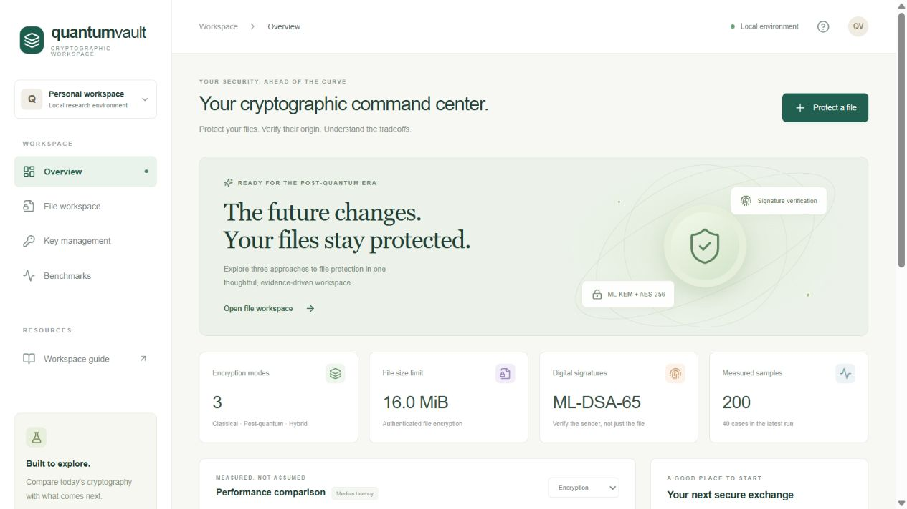
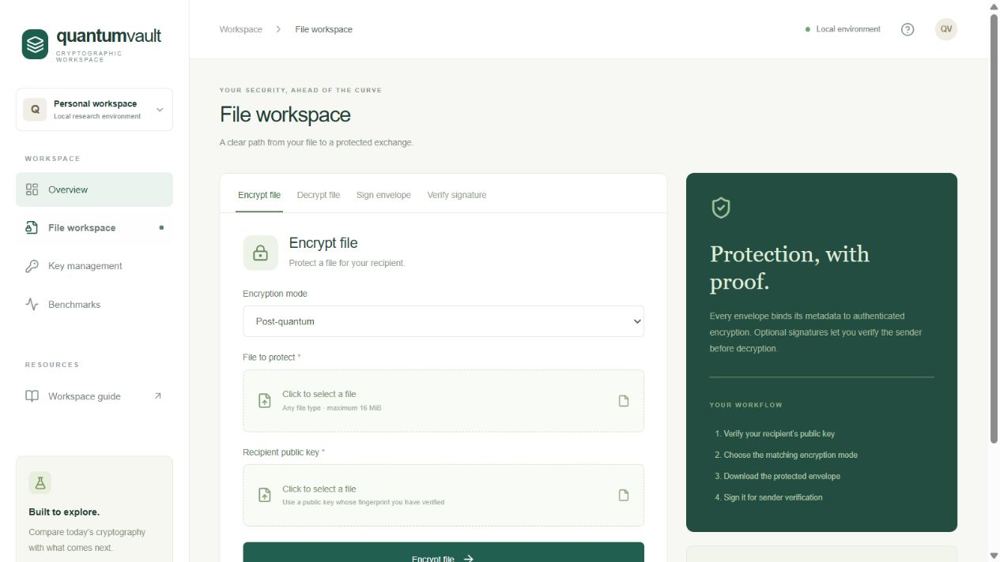
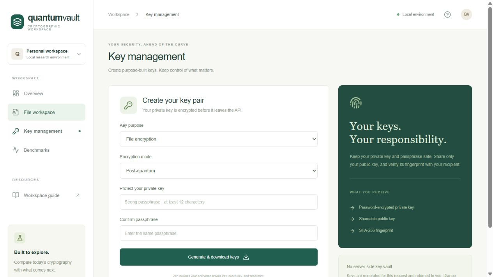
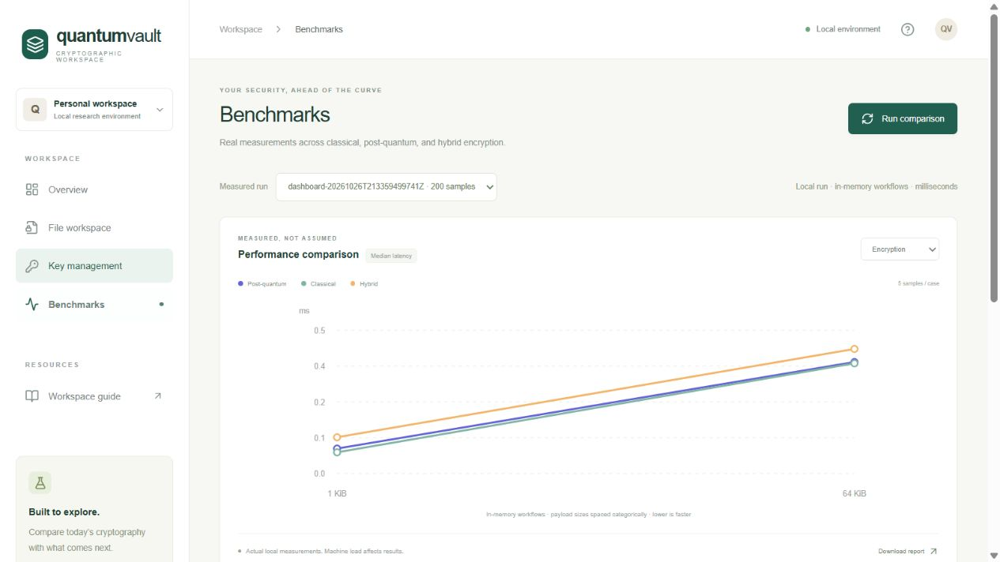

# QuantumVault

**Post-quantum file protection, digital signatures, and measured cryptographic comparisons.**

QuantumVault is a local research platform with a **Next.js + TypeScript frontend**, a **Django API**, and a Python cryptographic engine. Encrypt files, verify their origin, manage password-protected keys, and compare classical, post-quantum, and experimental hybrid key establishment.



## Features

- **Three encryption modes:** classical X25519, post-quantum ML-KEM-768, and an experimental X-Wing draft-based strict hybrid variant.
- **Authenticated file encryption:** HKDF-SHA-256 key derivation and AES-256-GCM, with envelope metadata authenticated alongside ciphertext.
- **Digital signatures:** ML-DSA-65 signatures with independently trusted signer keys and signature-required decryption.
- **Protected key downloads:** password-encrypted private keys, raw public keys, and SHA-256 fingerprints packaged in a ZIP.
- **Benchmark dashboard:** operation filters, historical runs, latency charts, and downloadable reports using actual measurements.
- **Privacy-conscious local workflows:** uploaded files, private keys, and plaintext are processed in memory rather than persisted by Django.
- **CLI and automated checks:** the same Python engine powers the dashboard, command-line workflows, and tests.

## Screenshots

### File workspace

Encrypt/decrypt files and create or verify detached envelope signatures.



### Key management

Create separate encryption and signing keys, with encrypted private-key downloads.



### Benchmark analysis

Compare measured latency across modes, select operations and runs, and export reports.



Screenshots show the running local application. Measurement counts vary by benchmark configuration; screenshots include a small 200-sample dashboard run.

## Technology

| Layer | Stack |
| --- | --- |
| Frontend | Next.js 16, React 19, TypeScript, CSS, Lucide icons |
| Backend | Django 5.2, Python 3.11+ |
| Cryptography | PyCA cryptography 50.0.2 / OpenSSL |
| Key establishment | X25519, ML-KEM-768, experimental hybrid |
| File protection | HKDF-SHA-256, AES-256-GCM |
| Signatures | ML-DSA-65 |
| Benchmarks | Python high-resolution timers; JSON, CSV, Markdown exports |

## Quick start

Prerequisites: Python 3.11+ and Node.js 20.9+ (tested locally with Python 3.12 and Node.js 24).

```powershell
git clone https://github.com/Aritro123456/Quantum_Vault.git
cd Quantum_Vault
python -m venv .venv
.\.venv\Scripts\python.exe -m pip install -r backend/requirements.txt
```

Start Django:

```powershell
.\.venv\Scripts\python.exe backend/manage.py runserver 127.0.0.1:8001 --noreload
```

In a second terminal, from the repository root:

```powershell
cd frontend
npm ci
npm run dev
```

Open **[http://127.0.0.1:3000](http://127.0.0.1:3000)**. Both servers must be running. Next.js forwards same-origin `/api` requests to Django on port 8001. No database, migrations, or external API credentials are required.

On macOS/Linux, use `python3 -m venv .venv` and `.venv/bin/python` instead of the Windows Python executable paths above. The frontend commands are unchanged.

## First protected exchange

1. Generate a recipient encryption key pair and choose its mode.
2. Share the recipient public key and independently verify its fingerprint.
3. Encrypt a file using that public key and the matching mode.
4. Generate a separate ML-DSA-65 signing key pair, then sign the encrypted envelope.
5. Decrypt with the recipient private key, detached signature, and trusted signer public key. The dashboard requires a valid signature by default.

Plaintext files are limited to **16 MiB**. Existing CLI outputs are not overwritten. Downloaded files and keys are stored according to your browser settings and must be handled appropriately.

## CLI

Run the synthetic signed round-trip demo across all three modes:

```powershell
.\.venv\Scripts\python.exe examples/demo.py
```

Generate recipient keys, encrypt, and decrypt (CLI unsigned workflow):

```powershell
.\.venv\Scripts\python.exe app.py keygen --private runtime/recipient.pem --public runtime/recipient.pub
.\.venv\Scripts\python.exe app.py encrypt examples/message.txt runtime/message.qv --key runtime/recipient.pub
.\.venv\Scripts\python.exe app.py decrypt runtime/message.qv runtime/restored.txt --key runtime/recipient.pem
```

Private-key passwords are prompted interactively. For hybrid mode, add `--mode hybrid` consistently to key generation, encryption, and decryption, and use a `.json` private-key filename. Classical mode uses `--mode classical`. Default mode is `postquantum`; there is no automatic fallback.

Sign and require sender verification:

```powershell
.\.venv\Scripts\python.exe app.py keygen --purpose signing --private runtime/signer.pem --public runtime/signer.pub
.\.venv\Scripts\python.exe app.py sign runtime/message.qv runtime/message.qvsig --key runtime/signer.pem
.\.venv\Scripts\python.exe app.py verify runtime/message.qv runtime/message.qvsig --key runtime/signer.pub
.\.venv\Scripts\python.exe app.py decrypt runtime/message.qv runtime/verified.txt --key runtime/recipient.pem --signature runtime/message.qvsig --signer-key runtime/signer.pub
```

## Measured benchmarks

The included [initial comparison report](benchmarks/results/initial-comparison/report.md) contains **68 cases and 2,040 measured samples**, with 30 repetitions per case after three warmups. [Raw JSON](benchmarks/results/initial-comparison/results.json) and [CSV summaries](benchmarks/results/initial-comparison/summary.csv) preserve the measurements.

```powershell
.\.venv\Scripts\python.exe app.py benchmark
```

Each new run creates a fresh output directory. Measurements separate key generation, encapsulation/decapsulation, signatures, AES-GCM bulk work, and full in-memory envelope workflows. Disk I/O, password-protection time, startup, and network are excluded. Local timing variation and fixed execution order mean this single run does not establish a reliable speed ranking or security-strength comparison.

## Verification

**35 core tests + 5 Django API tests passed**, alongside the frontend production build. Tests cover round trips, tampering, malformed envelopes, wrong keys/signers, mode mismatch, signature-required decryption, CSRF, upload limits, benchmark exports, and API workflows. Three published draft vectors validate hybrid key generation and decapsulation.

```powershell
.\.venv\Scripts\python.exe run_tests.py
.\.venv\Scripts\python.exe backend/manage.py test api
.\.venv\Scripts\python.exe backend/manage.py check
cd frontend
npm run build
```

Browser checks confirmed real benchmark data loading, a benchmark run updating the charts, and encrypted key-bundle downloads.

## Project structure

```text
backend/                 Django API and endpoint tests
frontend/                Next.js dashboard
src/quantum_vault/       Cryptographic engine, CLI, benchmarks, reporting
examples/                Synthetic demo and sample plaintext
tests/                   Core unit/integration tests and public test vectors
docs/                    Design notes, setup guide, screenshots
benchmarks/results/      Included public measurements and ignored new runs
reports/templates/       Migration-assessment template
runtime/                 Ignored local keys and outputs
```

## Design and limits

This is a **local research application**, not an independently audited production encryption product. Cryptographic primitives are delegated to the provider; protocol integration is application-specific. The experimental `XWING-D10-STRICT` suite follows a pinned X-Wing draft construction with stricter low-order X25519 rejection and does not claim full X-Wing conformance.

Public-key authentication remains the caller’s responsibility. Signatures do not prevent replay, and static recipient-key workflows do not provide forward secrecy. Production authentication, multi-user isolation, public hosting, and certification are not implemented. Keep the development servers bound to loopback.

Read the [dashboard/API guide](docs/dashboard.md), [cryptographic design](docs/crypto_design.md), [encryption modes](docs/encryption_modes.md), [signature format](docs/signature_format.md), [threat model](docs/threat_model.md), and [benchmark methodology](docs/benchmark_plan.md).
